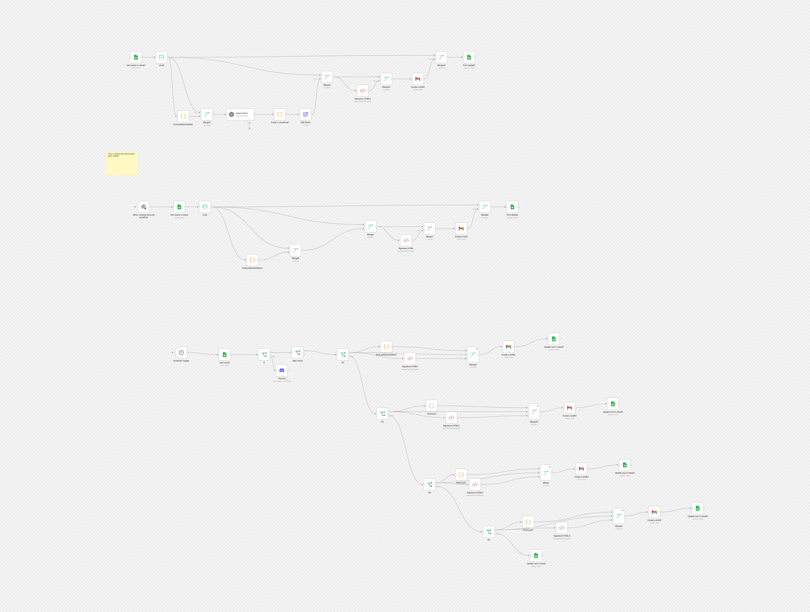

# Email Follow-Up Sequence

Reads a contact list from Google Sheets, writes a first-touch email and up to four date-gated follow-ups, and saves each one as a Gmail draft. Every stage writes a sent flag back to the sheet so a contact never gets the same stage twice. A Discord message reports each run.

Built for my own outreach while I was at SellSide Group. It cut manual outreach work from about 15 to about 4 hours a week.

## At a glance

- Nodes: 54
- Integrations: discord, gmail, googleSheets, openAi

## Setup

1. In n8n, open **Workflows → Import from File** and select the JSON.
2. Create these credentials and select them on the nodes that need them: `discordWebhookApi`, `gmailOAuth2`, `googleSheetsOAuth2Api`, `openAiApi`.
3. Replace the placeholders below with your own values.

## Placeholders

Values were removed from the export and replaced with:

- `555-555-0100`
- `YOUR_GOOGLE_SHEETS_ID`
- `YOUR_PROFILE`
- `name@example.com`
